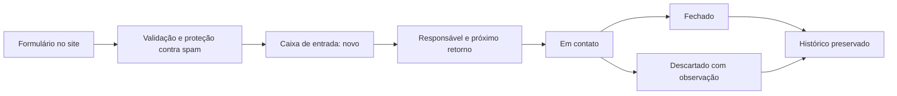

# Fluxos de gestão HS Logística

## Cotações

O painel não cria pedidos. Os dados enviados pelo visitante são preservados. A equipe atua na situação, responsável, prioridade, data de retorno e notas. Busca por cliente/contato/mensagem, filtros combináveis por situação, serviço, responsável, prioridade e período; paginação e exportação CSV respeitam as permissões. Exportações protegem contra fórmulas de planilha. Nenhuma exclusão em massa no fluxo de atendimento.

## Equipe

Administrador gerencia contas. Editor cuida do site e blog. Atendimento trabalha nas cotações. Um perfil personalizado concede permissões específicas, incluindo publicação e exportação separadas. Desativar uma conta bloqueia novas entradas e invalida sessões. O último administrador ativo e a própria conta são protegidos contra exclusão ou perda de administração. Atividades administrativas ficam registradas sem senhas ou tokens.

## Conteúdo

Página inicial e identidade continuam usando as mesmas APIs e dados. Um editor guiado reúne os campos por tarefa e mantém o rascunho local enquanto o usuário trabalha. Exibe erros de validação, avisa antes de descartar mudanças e só confirma publicação quando o salvamento termina. Cabeçalho inclui logomarca, tamanho e visibilidade do nome, navegação e botão principal. Home inclui textos, fotos, serviços, etapas, empresa, dúvidas, visibilidade de seções e formulário. Configurações incluem contato, cores, rodapé e SEO.

Blog mantém editor rico, rascunhos, publicação e histórico. Usuários sem permissão de publicar não publicam pela interface nem pela API. Mídia exige texto alternativo e protege arquivos em uso contra exclusão. Dashboard e navegação mostram apenas áreas autorizadas.

## Validação antes de produção

Banco clonado e domínio de homologação; migrations geradas e aplicadas nesse banco primeiro. Matriz de testes com administrador, editor, atendimento, perfil personalizado e visitante; tentativa de elevação de acesso e sessão desativada. Envio real do formulário até a caixa de entrada. Edição de logo, texto, menu e seções refletida na web. Publicação, rascunhos, uploads, filtros e exportação. Revisão desktop e celular. Backup antes de aplicar a versão no Dokploy.
